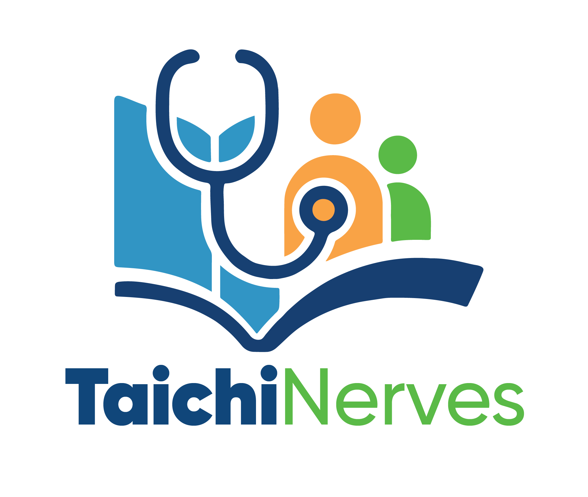
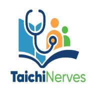
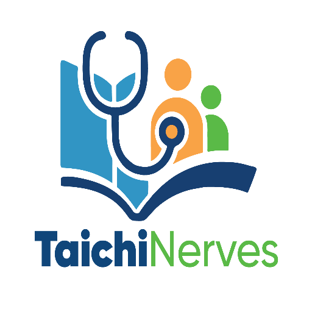

# 🏥 Taichi Nerves Academy

<div align="center">
  
  
  <h3>Empowering Healthcare Students with Quality Medical Education</h3>
  
  
  
  <p style="margin: 20px 0;">
    
    
    
  </p>
  
  <p>
    <a href="#demo">
      
    </a>
    <a href="#issues">
      
    </a>
    <a href="#features">
      
    </a>
  </p>
</div>

---

## 📋 Table of Contents

- [🎯 About The Project](#-about-the-project)
- [✨ Features](#-features)
- [🛠️ Tech Stack](#️-tech-stack)
- [🚀 Getting Started](#-getting-started)
  - [Prerequisites](#prerequisites)
  - [Installation](#installation)
  - [Environment Variables](#environment-variables)
- [💡 Usage](#-usage)
  - [For Students/Learners](#for-studentslearners)
  - [For Admins](#for-admins)
- [📁 Project Structure](#-project-structure)
- [🎛️ Admin Dashboard](#️-admin-dashboard)
- [🗄️ Database Schema](#️-database-schema)
- [🚀 Deployment](#-deployment)
- [🤝 Contributing](#-contributing)
- [📝 License](#-license)
- [📧 Contact](#-contact)

## About The Project

Taichi Nerves Academy is a comprehensive medical education platform designed specifically for healthcare students and professionals. The platform provides high-quality, subscription-based learning resources including video lectures, study notes, podcasts, and interactive quizzes across various medical topics.

### Why Taichi Nerves?

- **Comprehensive Content**: Video lectures, study notes, podcasts, and quizzes
- **Medical Focus**: Tailored for healthcare students (medical, nursing, allied health)
- **Affordable**: Flexible subscription plans (monthly/annual)
- **Accessible**: Responsive design works on desktop, tablet, and mobile
- **Secure**: Enterprise-grade authentication and data protection
- **Analytics**: Track your learning progress and performance

## Features

### For Learners

---

- 🎥 **Video Lectures**: High-quality educational videos covering major medical topics
- 📖 **Study Notes**: Comprehensive downloadable notes and materials
- 🎧 **Podcasts**: Learn on-the-go with educational audio content
- 🧠 **Interactive Quizzes**: Test your knowledge and track progress
- 🔍 **Smart Search**: Find content quickly with advanced filtering
- 📈 **Progress Tracking**: Monitor your learning journey
- 🏷️ **Topic Categories**: Organized content (Anatomy, Physiology, Pathology, Pharmacology, etc.)

### For Admins

---

- **Comprehensive Dashboard**: Real-time analytics and insights
- **Content Management**: Easy upload and management of all content types
- **User Management**: View users, manage subscriptions, and access controls
- **Media Library**: Organized content library with search and filters
- **Role-Based Access**: Granular permissions for different admin roles
- **Analytics**: Content performance, user engagement, and subscription metrics
- **Settings**: Platform configuration and customization

---

## Tech Stack

### 🎨 Frontend

---
- **Framework**: React 18 with TypeScript
- **Build Tool**: Vite
- **Styling**: Tailwind CSS
- **UI Components**: Radix UI + shadcn/ui
- **Icons**: Lucide React
- **Routing**: React Router v6
- **State Management**: TanStack Query (React Query)
- **Forms**: React Hook Form
- **Charts**: Recharts

### 🗄️ Backend & Services

---
- **Database**: Supabase (PostgreSQL)
- **Authentication**: Supabase Auth / Clerk
- **Storage**: Supabase Storage
- **Payments**: Stripe
- **Hosting**: Netlify

### 🛠️ Development Tools

---
- **Version Control**: Git & GitHub
- **Package Manager**: npm
- **Linting**: ESLint
- **Formatting**: Prettier
- **Type Checking**: TypeScript

---

## Getting Started

> **Follow these steps to set up the project locally and start contributing.**

### Prerequisites

---

- **Node.js** (v18 or higher)
- **npm** or **yarn**
- **Git**
- **Supabase Account** (free tier available)
- **Clerk Account** (optional, for authentication)
- **Stripe Account** (optional, for payments)

### Installation

---

#### Clone the repository

```bash
git clone https://github.com/panna254/taichi-nerves-academy.git
cd taichi-nerves-academy
```

#### Install dependencies

```bash
npm install
```

#### Set up environment variables

```bash
cp .env.example .env
# Edit .env with your credentials (see Environment Variables section)
```

#### Set up Supabase database

---

1. **Create a new Supabase project**
2. **Run the SQL schema** from `database/schema.sql` in Supabase SQL Editor
3. **Create storage buckets**: `videos`, `notes`, `podcasts`, `temp`

#### Start development server

```bash
npm run dev
```

#### Open your browser

Navigate to **http://localhost:5173**

### Environment Variables

> **Important**: Never commit your `.env` file to version control!

Create a `.env` file in the root directory with the following variables:

```env
# Supabase
VITE_SUPABASE_URL=your_supabase_project_url
VITE_SUPABASE_ANON_KEY=your_supabase_anon_key

# Clerk Authentication (if using Clerk)
VITE_CLERK_PUBLISHABLE_KEY=your_clerk_publishable_key

# Daraja/PayHero Payments (optional)
VITE_APP_ENV=development
```

## Usage

### For Students/Learners

- **Sign Up**: Create an account with email
- **Choose Plan**: Select monthly or annual subscription
- **Complete Payment**: Secure checkout via Stripe
- **Access Content**: Browse topics and start learning
- **Track Progress**: Monitor your learning journey

### For Admins

- **Admin Access**: Contact admin to grant access
- **Login**: Use /admin route
- **Upload Content**: Add videos, notes, podcasts, quizzes
- **Manage Users**: View and manage subscriptions
- **Monitor Analytics**: Track platform performance


## Project Structure

```bash
taichi-nerves-academy/
├── public/                 # Static assets
│   ├──logo.png
│   ├──hero-medical-education.jpg
│   ├──placeholder.jpg
│   └──app icons (android-chrome-*.png, apple-touch-icon.png)
├── src/
│   ├── components/         # React components
│   │   ├── admin/         # Admin dashboard components
│   │   ├── layout/        # Layout components (Header, Footer)
│   │   ├── learner/       # Learner-facing components
│   │   └── ui/            # Reusable UI components
│   ├── hooks/             # Custom React hooks
│   │   ├── useAuth.tsx    # Authentication hook
│   │   ├── useSubscription.ts
│   │   └── useAdmin.ts
│   ├── lib/               # Utilities and configs
│   │   ├── supabase.ts    # Supabase client
│   │   └── utils.ts       # Helper functions
│   ├── pages/             # Page components
│   │   ├── admin/         # Admin pages
│   │   ├── Home.tsx
│   │   ├── Topics.tsx
│   │   ├── Resources.tsx
│   │   └── Membership.tsx
│   ├── services/          # API services
│   │   ├── adminService.ts
│   │   ├── analyticsService.ts
│   │   └── contentService.ts
│   ├── types/             # TypeScript type definitions
│   ├── App.tsx            # Main App component
│   ├── main.tsx           # Entry point
│   └── index.css          # Global styles
├── database/
│   └── schema.sql         # Database schema
├── .env.example           # Environment variables template
├── package.json
├── tsconfig.json
├── vite.config.ts
└── README.md
```

Admin Dashboard
The admin dashboard provides comprehensive content management capabilities:

### Features

- **Dashboard**: Overview with key metrics and analytics
- **Media Library**: Manage all content (videos, notes, podcasts, quizzes)
- **Users & Roles**: User management and subscription control
- **Analytics**: Content performance and user engagement
- **Settings**: Platform configuration

### Access Admin Dashboard

- **Navigate to** `/admin`
- **Login with** admin credentials
- **Explore the** dashboard features

### Making a User Admin

Run this SQL in Supabase SQL Editor:

```sql
-- Find user ID
SELECT id, email FROM users WHERE email = 'admin@example.com';

-- Grant admin access
INSERT INTO admin_users (user_id, role)
VALUES ('user-id-here', 'admin');
```

Database Schema

### Core Tables

---

- **users**: User accounts and profiles
- **subscriptions**: Subscription records and status
- **topics**: Content categories
- **video_lectures**: Video content
- **notes**: Study materials
- **podcasts**: Audio content
- **quizzes**: Quiz metadata
- **quiz_questions**: Quiz questions and answers
- **user_progress**: Learning progress tracking
- **admin_users**: Admin role assignments

### Setup Database

---

- **Run the complete schema** located in `database/schema.sql` in your Supabase SQL Editor

### 🔑 Key Features

---

- **Row Level Security (RLS)** enabled
- **Foreign key constraints**
- **Indexes for performance**
- **Audit logging support**
- **Soft delete capability**

Deployment
Deploy to Netlify

### 🌐 Deploy to Netlify

#### 🔗 Connect Repository

- **Login to** Netlify
- **Click** "Add new site" → "Import an existing project"
- **Select your** GitHub repository

#### ⚙️ Configure Build Settings

- **Build command**: `npm run build`
- **Publish directory**: `dist`

#### Add Environment Variables

- **Go to** Site settings → Environment variables
- **Add all** variables from `.env.example`

#### Deploy

- **Click** "Deploy site"
- **Wait for** build to complete

### Custom Domain (Optional)

- **Go to** Domain settings in Netlify
- **Add custom** domain
- **Configure DNS** records at your domain registrar
- **Enable HTTPS** (automatic with Netlify)


Contributing
Contributions are what make the open-source community amazing! Any contributions you make are greatly appreciated.

### How to Contribute

- **Fork the Project**
- **Create your Feature Branch**
```bash
git checkout -b feature/AmazingFeature
```
- **Commit your Changes**
```bash
git commit -m 'Add some AmazingFeature'
```
- **Push to the Branch**
```bash
git push origin feature/AmazingFeature
```
- **Open a Pull Request**

### Development Guidelines

- **Follow existing code style and conventions**
- **Write meaningful commit messages**
- **Add comments for complex logic**
- **Test your changes thoroughly**
- **Update documentation as needed**


### License
Distributed under the MIT License. See LICENSE for more information.

### Contact
**Project Maintainer:** Moses Oketch

- **Email:** - oketchonyango19@gmail.com
- **GitHub:** - @panna254
- **Project Link:** - https://github.com/panna254/taichi-nerves-academy


## 🙏 Acknowledgments

---

- **React** - UI framework
- **Supabase** - Backend and database
- **Tailwind CSS** - Styling
- **Netlify** - Hosting
- **Daraja/PayHero** - Payment processing
- **Lucide Icons** - Beautiful icons
- **shadcn/ui** - UI components
- **Medical education community** for inspiration

## 🗺️ Roadmap

### ✅ Current Features (v1.0)

---

- **User authentication** and authorization
- **Subscription management**
- **Video lectures**
- **Study notes**
- **Podcasts**
- **Interactive quizzes**
- **Admin dashboard**
- **Content management**
- **Analytics**

### 🔲 Planned Features (v2.0)

---

- **Mobile app** (React Native)
- **Live webinars** and Q&A sessions
- **Discussion forums**
- **Peer-to-peer tutoring**
- **Certification programs**
- **AI-powered study recommendations**
- **Offline content access**
- **Multi-language support**
- **Social learning features**
- **Advanced analytics** and reporting


## 📊 Project Status

---

- **Current Version**: v1.0.0
- **Status**: Active Development
- **Last Updated**: May 2026
- **Next Milestone**: v1.1 - Enhanced Analytics

## Known Issues

---

- **See the** issues page for a list of known issues and planned improvements

## Support

Need help? Here's how to get support:

---

- **Documentation**: Check this README and inline code comments
- **Issues**: Open an issue on GitHub
- **Email**: Contact oketchonyango19@gmail.com
- **Community**: Join our discussions (coming soon)

## Additional Resources

---

- **Supabase Documentation**
- **React Documentation**
- **Tailwind CSS Documentation**
- **TypeScript Handbook**
- **Netlify Documentation**

## 📸 Screenshots

### 🏠 Landing Page
<div align="center">
  
</div>

### 📚 Resources Library
<div align="center">
  
</div>

### 🎛️ Admin Dashboard
<div align="center">
  
</div>

### 🎥 Video Player
<div align="center">
  
</div>

<div align="center">
Built for Healthcare Education
Star this repo if you find it helpful!
⬆ Back to Top
</div>